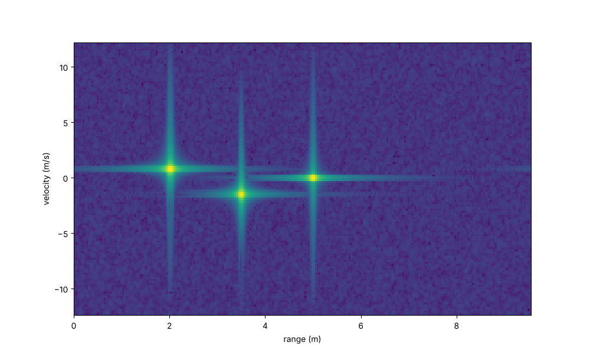
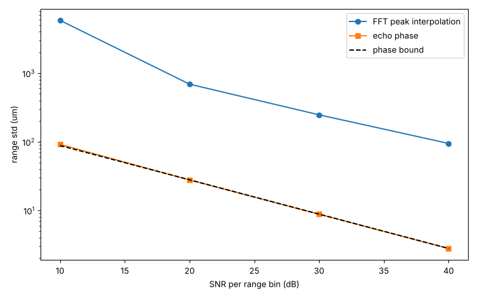
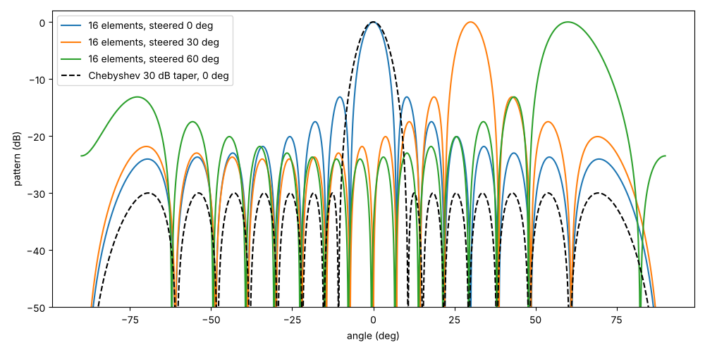
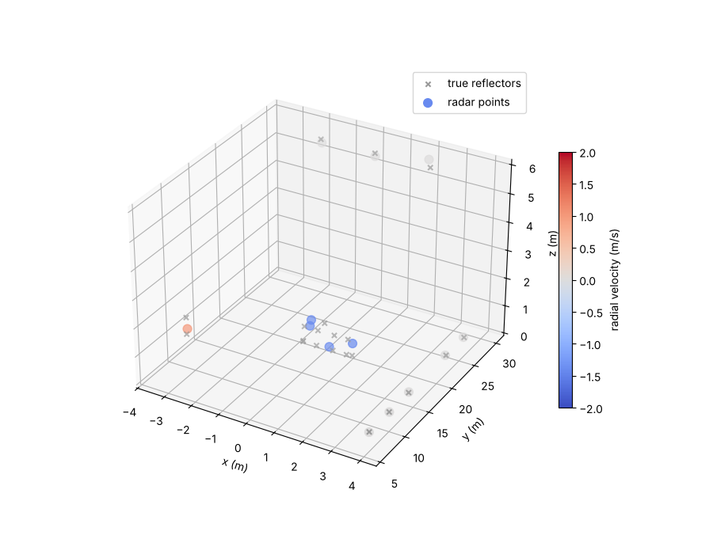
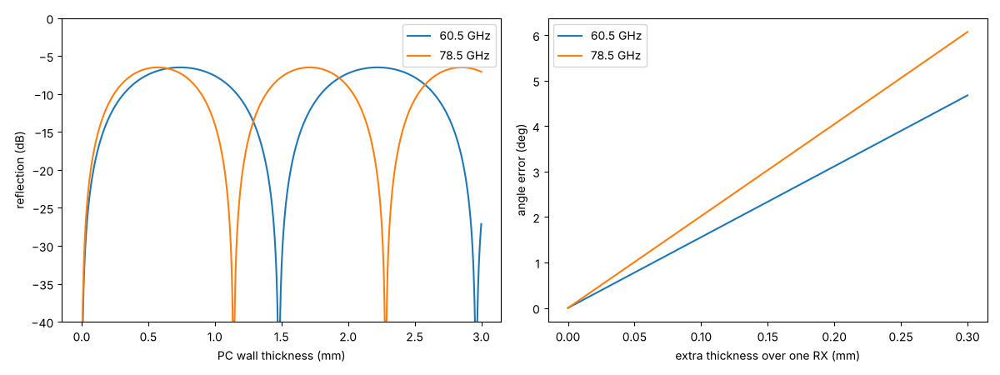
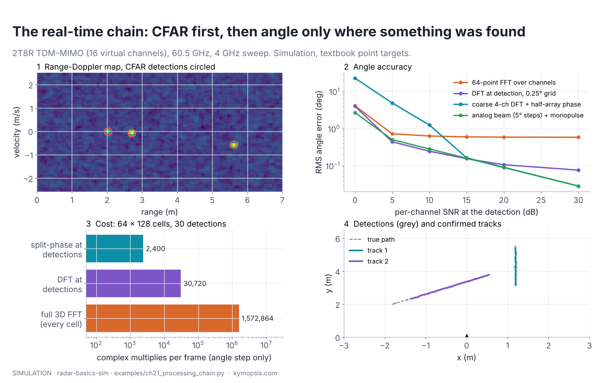

# radar-basics-sim

A small, readable **FMCW radar simulator** in Python with worked examples: beat frequency, range FFT and
range resolution, sub-bin range precision, range-Doppler maps, angle of arrival from phase differences,
TDM-MIMO virtual arrays, CFAR detection, and super-resolution (Capon, MUSIC).

It is the companion code for the **Radar Principles** series on the Kymopsis blog, which explains millimetre-wave
radar from the electromagnetic wave up to MIMO and 4D imaging: <https://kymopsis.com/series/radar-principles/>.
Each chapter's numbers come from the example script for that chapter, so you can rerun them and change the
assumptions. The published figures and animations use the same models but have their own layout code, which
is not part of this repository; the plots below are what the scripts here produce.

> Textbook point-target model for learning and prototyping signal processing. It is not a model of any
> specific radar chip or product, and results are simulations, not measurements.

## Quick start

```bash
git clone https://github.com/Kymopsis/radar-basics-sim
cd radar-basics-sim
pip install numpy matplotlib scipy   # or: pip install ".[plot]"
python examples/ch10_range_doppler.py      # prints each target's range and velocity, saves out/ch10_rd.png
```

```python
from radar_sim import make, Target, cube, rd_map

radar = make("2T4R", fc=60.5e9, bw=4e9, n_chirps=64)      # TDM-MIMO, 8 virtual channels
print(radar.summary())                                     # resolution, max range, max velocity
data = cube(radar, [Target(r=3.0, v=0.8, az=15)])          # [chirp, virtual channel, sample]
rd, ranges, velocities, _ = rd_map(radar, data)
```

## Examples (one per chapter)

| Script | What it solves | Chapter |
| --- | --- | --- |
| `examples/ch01_wavelength.py` | Wavelength, λ/2 spacing, motion per phase turn, wavelength in plastic | 1 · Waves and wavelength |
| `examples/ch02_phase_iq.py` | Displacement from unwrapped echo phase, I/Q circle | 2 · Phase and the I/Q signal |
| `examples/ch03_multipath.py` | Two-ray multipath: echo gain and nulls against range | 3 · Interference and multipath |
| `examples/ch04_antenna_aperture.py` | Gain and beamwidth from aperture size; directivity from beamwidths | 4 · Antennas: gain and beamwidth |
| `examples/ch05_beat_frequency.py` | Range from the beat frequency, R = fb·c / 2S | 5 · FMCW chirp and beat frequency |
| `examples/ch06_range_resolution.py` | When two targets merge into one peak (c/2B) | 6 · Range FFT and range bins |
| `examples/ch07_radar_equation.py` | Received SNR and detection range from the radar equation | 7 · Radar equation and SNR |
| `examples/ch08_peak_interpolation.py` | Range precision inside one bin vs SNR (Monte Carlo) | 8 · Precise range inside a bin |
| `examples/ch09_phase_precision.py` | Range precision from the FFT peak vs from echo phase, against SNR | 9 · Phase ranging |
| `examples/ch10_range_doppler.py` | Range-Doppler map, range and velocity per target | 10 · Doppler and slow time |
| `examples/ch11_micro_doppler.py` | Walking-person spectrogram; breathing and heart rate from phase | 11 · Micro-Doppler and vital signs |
| `examples/ch12_angle_fft.py` | Angle from the phase difference between receivers | 12 · Angle from phase |
| `examples/ch13_radome_wall.py` | Half-wave radome walls; angle error from an uneven cover | 13 · Radomes |
| `examples/ch14_mimo_virtual_array.py` | 1T4R vs 2T4R virtual array beamwidth | 14 · MIMO virtual arrays |
| `examples/ch15_ambiguity.py` | Velocity unfolding with two chirp intervals; TDM-MIMO fold test | 15 · Ambiguity and unfolding |
| `examples/ch16_cfar_tracking.py` | Pfa, CA/OS-CFAR loss, Albersheim, Kalman tracking with M-of-N confirmation | 16 · Detection and tracking |
| `examples/cfar_1d.py` | Cell-averaging CFAR detection on a range profile | 16 · Detection and tracking |
| `examples/ch17_beamforming.py` | Steering, grating lobes, tapers, beam squint, phase quantisation, MVDR | 17 · Beamforming and phased arrays |
| `examples/ch18_music_vs_fft.py` | Two close targets: FFT vs Capon vs MUSIC | 18 · Super-resolution |
| `examples/ch19_4d_point_cloud.py` | 12TX/16RX cascade-style array: range-Doppler CFAR, azimuth and elevation, point cloud | 19 · 4D imaging radar |
| `examples/ch20_frequency_bands.py` | 24 vs 60 vs 77–81 GHz: wavelength, resolution, gain, beamwidth, oxygen loss | 20 · Choosing the band |
| `examples/ch21_processing_chain.py` | Real-time chain: 2-D CFAR, single-cell Doppler DFT, angle only at detections (3D FFT vs DFT vs subarray phase comparison, accuracy and cost), multi-target tracker | 21 · The processing chain |

**Renumbered 2026-11-09.** The series was reordered into teaching order (antennas moved to chapter 4, the radar
equation to 7, CFAR and tracking to 16, and so on), and the scripts were renamed to match. The old file names still
work: each is a short stub that runs the new script, so links and commands written before the change keep working.

| Old name (still runs) | New name |
| --- | --- |
| `examples/ch04_radar_equation.py` | `examples/ch07_radar_equation.py` |
| `examples/ch07_peak_interpolation.py` | `examples/ch08_peak_interpolation.py` |
| `examples/ch08_phase_precision.py` | `examples/ch09_phase_precision.py` |
| `examples/ch09_range_doppler.py` | `examples/ch10_range_doppler.py` |
| `examples/ch10_micro_doppler.py` | `examples/ch11_micro_doppler.py` |
| `examples/ch11_angle_fft.py` | `examples/ch12_angle_fft.py` |
| `examples/ch12_antenna_aperture.py` | `examples/ch04_antenna_aperture.py` |
| `examples/ch14_cfar_tracking.py` | `examples/ch16_cfar_tracking.py` |
| `examples/ch15_mimo_virtual_array.py` | `examples/ch14_mimo_virtual_array.py` |
| `examples/ch16_ambiguity.py` | `examples/ch15_ambiguity.py` |

The chain's building blocks (`ca_cfar_2d`, `peaks_2d`, `doppler_dft_at`, `angle_dft_at`, `angle_split_phase`,
`op_counts`, `Tracker`) live in `radar_sim/pipeline.py` and are exported from `radar_sim`.

Every script runs with `--no-plot` to print results only. Without it, a plot is saved to `out/`.
A guided tour in one notebook: [`notebooks/quickstart.ipynb`](notebooks/quickstart.ipynb).

## Example output

| | |
| --- | --- |
|  |  |
| Ch. 10: range-Doppler map | Ch. 9: echo phase reaches the micrometre bound, FFT peak does not |
|  |  |
| Ch. 16: CA/OS-CFAR thresholds and a Kalman track through false alarms | Ch. 17: steered and tapered beams |
|  |  |
| Ch. 19: simulated 4D point cloud | Ch. 13: half-wave walls and cover-induced angle error |
|  | |
| Ch. 21: CFAR, angle at detections only, tracks | |

All images in `docs/images/` are regenerated by running the examples without `--no-plot`.

## What is modelled

- Linear FMCW chirps, complex (I/Q) dechirped baseband, ideal point targets with range, radial velocity,
  azimuth, elevation and amplitude; additive white Gaussian noise.
- Range migration within a frame (targets move between chirps) and TDM-MIMO timing (each transmitter in turn).
- Antenna layouts in units of wavelength (`LAYOUTS`: 1T2R, 2T2R, 1T4R, 2T4R, 3T4R). These are generic
  textbook arrangements. The chapter 19 cascade layout is our own reconstruction of the counts TI publishes for
  its 4-chip cascade reference design (12 TX, 16 RX, an 86-element λ/2 azimuth row), not copied from TI files.

Not modelled: antenna patterns, coupling, phase noise, IF filtering, ADC quantisation, multipath and
clutter (some chapters add these explicitly in their own scripts).

## Formulas used

| Quantity | Formula |
| --- | --- |
| Beat frequency | fb = 2·S·R / c, S = B / Tc |
| Range resolution | ΔR = c / 2B (B = swept bandwidth actually sampled) |
| Maximum range (complex ADC) | Rmax = fs·c / 2S |
| Maximum unambiguous velocity | vmax = λ / 4Tc' (Tc' = time between chirps of the same transmitter) |
| Velocity resolution | Δv = λ / 2N·Tc' |
| Phase difference between receivers | Δφ = 2π·d·sin θ / λ |

## Tests

```bash
pip install pytest && pytest -q
```

## License

MIT, see [LICENSE](LICENSE). Made by [Kymopsis](https://kymopsis.com), maker of 60 GHz and 80 GHz radar
development kits.
